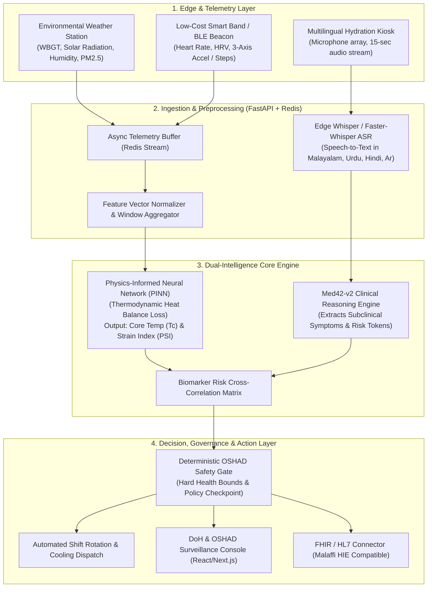

# 01 — System Architecture: BioThermal Twin
*High-Throughput, Physics-Grounded Workforce Health Intelligence Engine*

---

## 1. High-Level Architecture Overview

BioThermal Twin connects physical workers, microclimate environmental telemetry, clinical AI reasoning, and regulatory health dashboards into a unified reactive event pipeline.



---

## 2. Multi-Tier Component Breakdown

### Tier 1: Edge & Telemetry Ingestion Layer
* **Microclimate Station:** Ingests local ambient dry-bulb temperature ($T_a$), wet-bulb temperature ($T_w$), black-globe temperature ($T_g$), and relative humidity (RH) sampled at 1-minute intervals.
* **Non-Invasive Wearable Proxy:** Captures heart rate ($HR_t$), heart-rate variability ($HRV_t$), and step cadence from commodity low-cost smartbands ($<\$20$ enterprise beacons).
* **Hydration Kiosk Audio Stream:** Captures 16kHz audio clips of workers responding to short localized prompt questions at water stations or shift sign-ins.

### Tier 2: Real-Time Stream Normalization (FastAPI + Redis)
* High-throughput asynchronous ingestion built in **FastAPI** with **Redis Streams** as the ingestion shock-absorber.
* **Sliding Window Buffering:** Maintains temporal sliding windows (5-minute, 30-minute, 2-hour, and 24-hour moving aggregates) of physiological strain and environmental heat load.
* **Zero-Knowledge Privacy Gate:** Masks all biometric identifiers. Data is mapped to an anonymous `worker_hash` and `cohort_id` ($k \ge 25$) to ensure individual worker privacy and prevent punitive employer retaliation.

### Tier 3: Dual-Intelligence Core Engine
1. **The Physics-Informed Neural Network (PINN):**
   * Computes human thermal equilibrium based on thermodynamic energy conservation.
   * Outputs two primary continuous indices every 60 seconds:
     * **Estimated Core Body Temperature ($T_c(t)$):** Normal range: 36.5°C – 37.5°C. Critical threshold: $> 38.5^\circ\text{C}$ (acute thermal exhaustion) and $> 40.0^\circ\text{C}$ (clinical heatstroke).
     * **Physiological Strain Index (PSI):** Scaled from 0 (no strain) to 10 (extreme physiological danger).
2. **The Med42-v2 Clinical LLM Agent:**
   * Receives transcribed native-language dialogue from the Whisper ASR module.
   * Prompts Abu Dhabi's **Med42** clinical model to classify syndromic indicators across three primary clinical axes:
     * *Hydration Status:* e.g., dark tea-colored urine (oliguria/hematuria indicator).
     * *Neuromuscular Irritability:* e.g., calf spasms, muscle fasciculations (rhabdomyolysis indicator).
     * *Central Nervous System Fatigue:* e.g., disorientation, tunnel vision, excessive fatigue.
3. **Cross-Correlation Risk Fusion:**
   * Cross-references the physical strain ($PSI \ge 7.0$) with positive syndromic indicators from Med42.
   * If both signals align, the risk score is elevated to **CRITICAL (Tier 3)**, bypassing single-signal false alarms.

### Tier 4: Regulatory & Action Orchestration
* **Deterministic OSHAD Safety Gate:**
  * Similar to our proven architectural pattern in `razorpay-subscription-recovery-agent` and `SentinelAI`: the AI proposes, but a **deterministic, non-probabilistic safety gate executes**.
  * Checks alerts against official Abu Dhabi Public Health Center (ADPHC) heat stress guidelines.
* **Dispatch Actions:**
  * **Shift Dispatch:** Automatically notifies the site supervisor's device to initiate a mandatory 20-minute rest-and-cooling break for Cohort B in Shaded Zone 3.
  * **Electrolyte Station Dispatch:** Dispatches targeted electrolyte replenishment to flagged work zones.
  * **Malaffi HIE Connector:** Generates standard HL7/FHIR observation resources for occupational health clinics.

---

## 3. API Route Specifications (FastAPI)

```
POST   /api/v1/telemetry/ingest           -> Ingests batch microclimate & wearable streams
POST   /api/v1/voice/check-in             -> Ingests native audio; runs Whisper + Med42 analysis
GET    /api/v1/worker/{worker_hash}/strain -> Returns live Core Temp (Tc), PSI, and 24h trajectory
GET    /api/v1/zone/{zone_id}/risk-map     -> Returns cohort-level heat strain matrix for dashboard
POST   /api/v1/interventions/dispatch     -> Generates OSHAD-compliant shift rotation directives
GET    /api/v1/compliance/oshad-report    -> Exports certified daily audit trail for ADPHC
```

---

## 4. Database Schema (PostgreSQL + TimescaleDB)

```sql
-- Environmental Microclimate Stream
CREATE TABLE environmental_telemetry (
    time TIMESTAMPTZ NOT NULL,
    zone_id VARCHAR(50) NOT NULL,
    ambient_temp_c NUMERIC(4,2),
    relative_humidity NUMERIC(4,2),
    wbgt_c NUMERIC(4,2),
    solar_radiation NUMERIC(6,2),
    pm25_index NUMERIC(5,2)
);

-- Anonymized Physiological Proxy Stream
CREATE TABLE physiological_telemetry (
    time TIMESTAMPTZ NOT NULL,
    worker_hash VARCHAR(64) NOT NULL,
    cohort_id VARCHAR(50) NOT NULL,
    heart_rate INT,
    heart_rate_variability INT,
    cadence_steps_per_min INT,
    estimated_core_temp NUMERIC(4,2),
    physiological_strain_index NUMERIC(3,1)
);

-- Med42 Multilingual Clinical Voice Logs
CREATE TABLE voice_syndromic_assessments (
    id UUID PRIMARY KEY DEFAULT gen_random_uuid(),
    created_at TIMESTAMPTZ DEFAULT NOW(),
    worker_hash VARCHAR(64) NOT NULL,
    detected_language VARCHAR(20),
    transcription TEXT,
    med42_clinical_summary TEXT,
    syndromic_risk_score NUMERIC(3,2), -- 0.00 to 1.00
    flagged_symptoms JSONB             -- e.g. ["dark_urine", "calf_cramp"]
);

-- Audited Intervention Log (Compliance with OSHAD SF)
CREATE TABLE oshad_interventions (
    id UUID PRIMARY KEY DEFAULT gen_random_uuid(),
    timestamp TIMESTAMPTZ DEFAULT NOW(),
    cohort_id VARCHAR(50) NOT NULL,
    trigger_reason TEXT,
    action_prescribed VARCHAR(100),    -- e.g. "MANDATORY_COOLING_CYCLE"
    supervisor_ack BOOLEAN DEFAULT FALSE,
    compliance_verified BOOLEAN DEFAULT FALSE
);
```

